# Cluster Themes

Redraws the whole instrument cluster in a theme of your choice. Open **Cluster Themes** from the apps menu on the center screen: its own page has the themes with pictures, the readouts, the badge, the Waze map, warnings and settings.

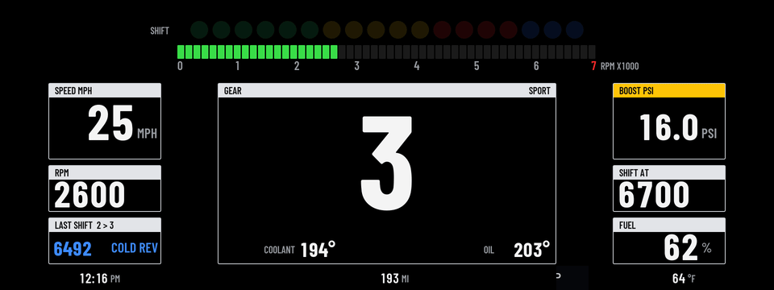

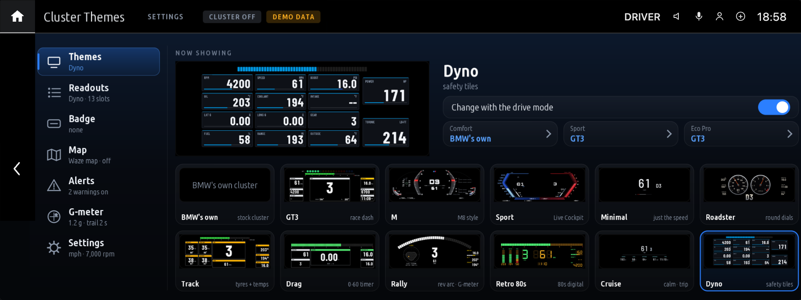

## Themes

Every theme fills the cluster and shows its own clock, range and outside temperature along the bottom, in the theme's style. Only BMW's gear letter at the bottom right stays uncovered: when a theme covers it, BMW draws a black box over the theme (issue #5). Every theme shows the drive mode (Comfort, Sport and so on) next to the gear.

### Apex

An original modern-supercar cockpit inspired by angular Italian instrument design, without manufacturer logos or copied artwork.

- **Top:** a curved 0–8000 rpm tach with paired rails that fill with engine speed, fine 100-rpm ticks fading before the lower arch, slightly thicker and longer 500-rpm marks, and short crisp ticks above heavy, square-cut numerals. The scale is progressive: lower thousands are closer together and higher thousands spread out. `shared/apex_tachometer.js` owns one mapping for tick positions, generated labels, RPM fill, warm-up boundary and the midpoint breaks in the lower white arc. All graduations follow the curve's local normal. The mapping is a theme design choice inspired by the reference, not claimed OEM calibration; it still displays actual RPM on a 0–8000 scale.
- **Shift lights:** ten lamps follow the tach's curve, each with two outer arcs and a flat glowing centre. All ten stay visibly blue at 45% brightness. A brighter blue glow builds from left to right over the final 2000 rpm before the active shift point. The whole row turns fully bright green from 100 rpm before the active shift point, and flashes red together at the configured rev limit (or the cold-engine guard's limit). The renderer alternates full/dim red four times per second, keeping the warning visible between pulses. Live, unsmoothed RPM starts/stops flashing; unknown RPM cancels it. This uses the app's limit setting, not a verified ECU limiter-active signal. Colour transitions blend briefly and respond to live rpm.

  This combines an always-on visual baseline with staged RPM cues. [MoTeC](https://motec.zendesk.com/hc/en-gb/articles/14583988308367-Checklist-SLM-Setup) supports per-stage LED colour and intensity; [AiM](https://www.aim-sportline.com/en/products/shift-light-module/index.htm) supports individual RPM thresholds; [CARTEK](https://www.cartekmotorsport.com/sequential-shift-light/) sequences toward the optimum shift point. The blue baseline, brightness levels, 2000-rpm approach band and green/red palette are choices for this theme, not a claimed Lamborghini factory calibration. Thresholds follow the app's shift-point and cold-guard settings.
- **Temperature panels:** one long coolant bar on the left and one long oil bar on the right, with pointed white/red enclosures following the measured visible edge. Each has a numeric Celsius readout, an identifying icon, 10°C ticks and fixed references inside the track. Pressure is omitted. The coolant enclosure is adapted to the left hood's lower outer edge; text stays upright when mirrored.

  [BMW M's S58 cooling-system explanation](https://www.bmw-m.com/en/topics/magazine-article-pool/bmw-m3-m4-cooling-system.html) gives oil around **100°C**, an approximate maximum oil temperature of **130°C**, and normal coolant at **90–105°C**. The oil track marks 100°C and 130°C; the coolant track brackets 90–105°C. Blue fades towards white approaching the operating reference. Oil trends towards red at the published approximate maximum; coolant above its typical band trends amber, not an asserted OEM overheat alarm. The 50–150°C oil and 50–130°C coolant display spans, colour interpolation and bar style are this theme's UI choices, not copied BMW ECU calibration or a guarantee that an engine is safe. BMW's own warnings and your car's manual remain authoritative. Missing signals read `--°C` with no live fill; out-of-range numbers remain visible while the bars clamp to their endpoints. These readouts stay in Celsius independently of the general unit setting.

Native-pixel geometry lives in `shared/apex_oil_panel.js` and `shared/apex_coolant_panel.js`; the layout's `oilPanel: [x, y]` and `coolantPanel: [x, y]` move the complete assemblies. Shared labels, mirroring, frames and bars live in `shared/apex_panel.js`; signal ranges, sourced references and formatting live separately in `shared/apex_gauge_values.js`. Run `node tools/test_apex_panels.js` to check references, unavailable signals, label fit, mirroring, edge clearance and shader budget. A local bench build contains an SDK stub: rebuild with the real SDK before installing on a car, and validate the layout and signals while stationary.
- **Fuel:** a slim right-hand curved rail with white quarter-scale ticks, 100/0 marks, a compact yellow pump icon, a small right-pointing filler-side arrow and numeric percentage. Antialiased bars follow a shallow curve with equal top/bottom edge insets; each compartment fills up to, but never across, its horizontal divider. The last quarter has a fixed red bracket like the supplied reference. The 25% region is a theme choice, not BMW's reserve-warning calibration; the icon stays yellow as an identifier, not a low-fuel warning. Missing fuel data reads `--%` with no fill, rather than masquerading as an empty tank. The existing fuel signal is reused (OBD percent when available, otherwise KombiIF litres divided by the configured tank size).

  This G80 project defaults to **59 L**, matching [BMW's M3 technical specifications](https://www.press.bmwgroup.com/united-kingdom/article/attachment/T0442590EN_GB/616649). Existing saved tank-size settings remain untouched: if yours still says 65 L from the original X3 configuration, change **Fuel tank size** to **59 L**. The gauge's geometry and icon are isolated in `shared/apex_fuel_gauge.js` and move together with the layout's `fuelGauge: [x, y]`.
- **Boost:** the fuel track is mirrored against the left display wall, with the same curved rail, quarter divisions and smooth segmented fill. An upright turbo icon and live psi/bar readout distinguish it from fuel. The span is 0–3 bar (0–43.5 psi), a UI scale, not a recommended boost target or OEM warning limit. The bar clamps to the scale while the numeric value remains visible. Missing/stale data shows dashes and no fill. It reuses the app's FES boost signal and existing configured DME fallback; no new signal subscription or vehicle write is added. `boostGauge: [x, y]` moves the entire mirrored assembly; its labels live in `shared/apex_boost_gauge.js` and its track shares the fuel renderer.
- **Middle:** a large outlined orange italic gear and speed readouts. Numeric gear changes have a 100 ms renderer-side slide/fade: up for upshifts and down for downshifts. The latest gear dominates immediately; rapid shifts replace the active transition, while P/R/N and unavailable values snap without animation. Glyphs are uploaded once, with no per-frame bitmap transfers; run `node tools/test_gear_display.js` to check playback and interruptions. The range cup is omitted; the bottom clock, range and outside-temperature status strip remains.
- **Engine-mode dial:** a bottom-left cropped half-dial sits immediately above the status strip, with a stepped red gear-shaped rim, fine radial spokes, a white inner arc edged in red and a dotted outer arc. COMFORT / SPORT / SPORT PLUS lettering follows the circular baseline letter by letter. Comfort is a display label for the same underlying Efficient engine setting; signal mapping is unchanged. The selected label becomes bold red immediately, while the short white indicator sweeps along the arc over 180 ms with a restrained red trail. Rapid changes redirect from the current visible angle; initial, unknown and forced-refresh states snap without queuing animations. M Setup's actual engine reading takes priority over generic drive mode; an invalid M reading leaves all modes unselected. No vehicle setting is changed. Artwork is generated with `uv run -q --with pillow python tools/bake_mode_dial.py`, cached per mode, and uploaded once per change; the renderer animates the indicator without per-frame bitmap transfers. Shader brightness follows night dimming. Run `node tools/test_apex_mode_dial.js` and `node tools/test_mode_dial_display.js` to check mode selection, source priority, unknown states, interruption, keyframes, dimming and placement. Bench previews deliberately inject Sport; the live G80 signal still needs stationary validation.
- **Odometer and range:** to the right of the speed, near the fuel gauge, a thin white rule sits above `000228km | [pump] 99km`-style readouts. Smaller units follow each number on its baseline, without fixed-column gaps, and a small fuel-pump icon precedes the range. Warning/EV icons are omitted. Both distances follow the selected km/mi units. Total mileage is read, never changed, from `KombiIF.statusRangeTankStatus.mileageKilometre`, using the [upstream Live Data mapping](https://github.com/cauliflowermossgrape/idrive7-apps/blob/main/apps/live_data/signals.js). Invalid/missing odometer values show dashes, not an invented zero; mileage beyond six digits is preserved rather than truncated. Vehicle support still needs stationary validation. Bench previews explicitly inject a 228 km sample; the application never fabricates a real odometer or derives one from trip distance. `shared/apex_distance_row.js` owns the presentation and `shared/vehicle_distances.js` owns validation/conversion; `distanceRow: [x, y]` moves the complete row. `node tools/test_hud_text.js` checks inline unit positioning and baseline alignment with the shipped fonts.
- **Motion:** a once-per-session 500 ms startup rail sweep ends with a 150 ms LED brightness pulse, only when starting stationary with known speed. Moving or losing speed data cancels it; gear, speed and warnings stay visible immediately. Numeric shifts add a brief orange glow to the existing slide/fade without changing the glyph's size or position. Mode changes briefly illuminate the dotted arc around the travelling indicator. Boost bars have short damping; temperature and fuel bars settle more gently, without delaying their numeric readouts, missing-data states or existing warning-side display regions. These regions are UI references, not new vehicle safety thresholds. Run `node tools/test_apex_motion.js` for startup, limiter playback and gauge response checks. All effects still require stationary validation on the real display.
- **Background:** the supplied graphite honeycomb image, compressed as a GPU texture. The tach and lamps sit below the G80's top-centre driver-camera housing.

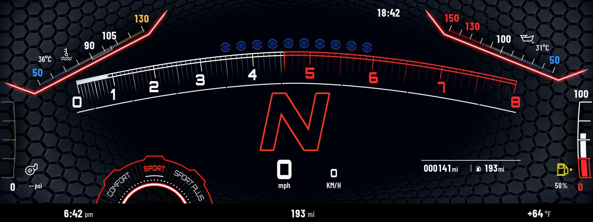

### GT3

A race dash.

- **Top:** 18 round shift lights (green, yellow, red, then blue) and a segmented rev bar. The lights come on from 3000 rpm and fill up to your shift point.
- **Left:** speed, rpm, and your last shift with its grade.
- **Middle:** the gear, with water and oil temperatures.
- **Right:** boost, your shift point, and fuel.
- **At the shift point** the lights, the rev bar, the rpm and the gear all go red.

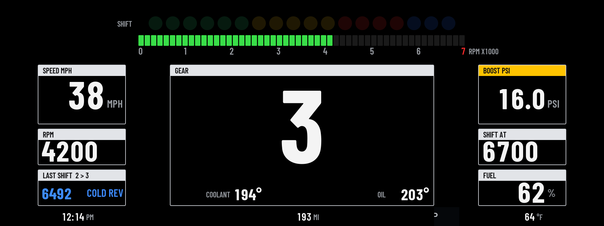

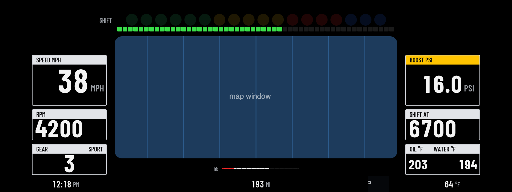

### M

A current M8's cluster, traced off a photo of it and drawn on black.

- **Middle:** two bowed glass rev blades either side of the gear and speed, reading 0 to 7000 rpm like the M40i's own cluster. A red marker rides each blade at the rpm, the blade glows below it, and orange and red marks sit before and past your redline. The gear shows with its shifter programme: P, D3, S3 or M3, and the drive mode sits under the speed.
- **Left:** a black card with a grey rim and four readouts where the M8 has its tyre block: boost, coolant, oil and intake air out of the box, each one changeable on the Readouts tab. The fuel dial sits over the card's lower corner, drawn like the M8's: a thin glass bracket inside a hatched chrome bezel, lit from the bottom up to the level, with a thin red line at the level.
- **Right:** what the engine, chassis, steering and gearbox are set to, as four rows with a step bar, and the oil temperature dial, the same glass bracket. The rows follow the drive mode buttons: Eco Pro, Comfort, Sport, Sport Plus and Sport Individual. The car only reports that an Individual setup is on, not what each part is set to, so those rows read INDIVIDUAL.
- **Bottom:** the clock, range and outside temperature, with BMW's own gear letter.
- **With the Waze map:** the blades keep their shape and numbers and move out to the sides, the map fills the middle between them, and the gear, speed and drive mode sit in a row under it.

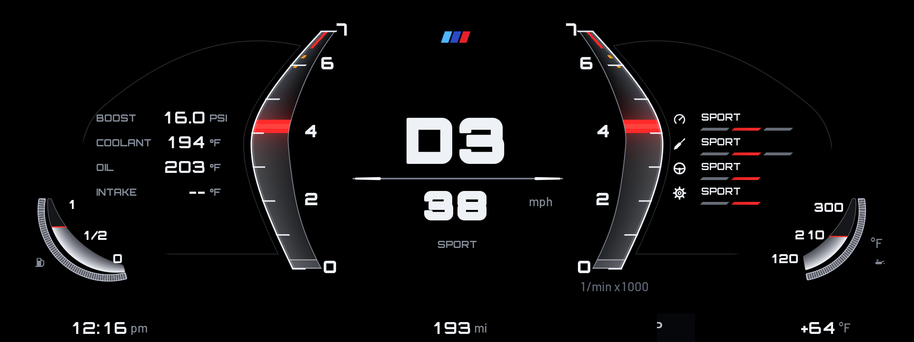

### Sport

The look of BMW's newer Live Cockpit Sport view.

- **Left:** speed as a blue bracket on BMW's 0 to 200 mph scale (0 to 320 km/h), with a fuel bar up its lower leg.
- **Right:** revs as a red bracket on the M40i's 0 to 7000 rpm scale, with yellow and red marks around your redline, with an oil temperature bar up its lower leg.
- **Middle:** the speed in big figures with the gear and drive mode under it, over a road like BMW's own Sport view whose lane dashes run towards you as you drive. With "Show Waze map inside the theme" on, the map takes the middle and the speed and gear move into the brackets.
- **Bottom:** boost and coolant in the blue and red bar. Under it, the clock, range and outside temperature, with BMW's own gear letter.

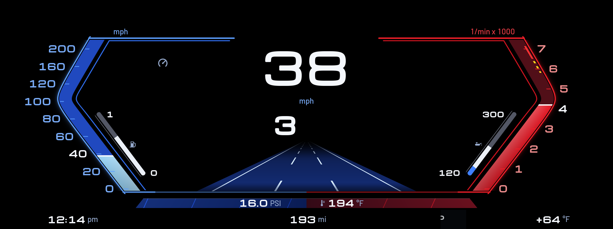

### M view

The look of the M view in the newer M cars' Live Cockpit (M3, M4, M5), for any car. Asked for in issue #15.

- **Left:** speed along a white line with rounded corners, 0 to 200 mph (0 to 330 km/h). The band inside the line lights up from 0 to the needle.
- **Right:** revs the same way, 0 to 8000 rpm, with yellow and red marks from your redline.
- **Panels:** dark grey panels inside both scales, and a red glow by the needle, as on BMW's own M view.
- **Middle:** the speed and the gear, each over its own line, with the speed in the other unit under it (km/h under mph, or the other way round) and the drive mode under the gear. With "Show Waze map inside the theme" on, the map shows in an oval window between the two scales that fades into the black, and the window opens and closes without the theme being built again.
- **Corners:** fuel on the far left and oil temperature on the far right, as small dials.
- **Bottom:** the clock, range and outside temperature, with BMW's own gear letter.

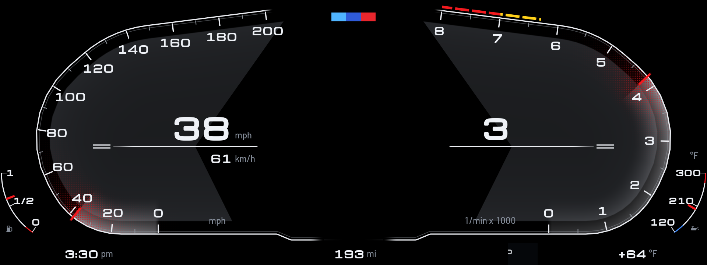

### Vector

A race-sim style dash with angled frames and a music panel.

- **Left:** a round rev counter in segments, 0 to 8000 rpm, red from your redline, with the speed and the gear inside it.
- **Middle:** boost, torque and power as bars. With "Show Waze map inside the theme" on, the map shows here instead.
- **Right:** coolant, oil, fuel and boost as rings, and the music panel: the song that is playing with its title, artist and time, read from the car's own now playing. When nothing is playing, the panel shows average speed, peak boost and lateral G instead. The music panel is experimental: please tell us in an issue whether it works with your sources (radio, Bluetooth, USB, CarPlay).
- **Bottom:** the clock, range and outside temperature, with BMW's own gear letter.

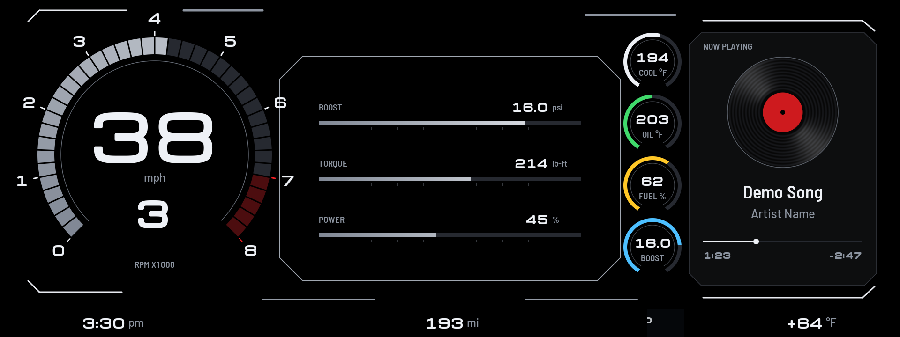

### Minimal

Just the speed, big, with the gear and drive mode beside it, a thin fuel line under it (the reserve end is red), and oil and coolant in small print.

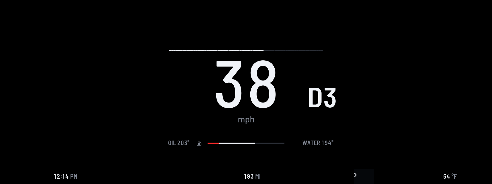

### Track

A race dash for track days: a shift bar across the top, a big gear with the speed under it, all four tyres (pressure and temperature, from the car's tyre monitor) on the left, oil, coolant and boost on the right (changeable), and fuel.

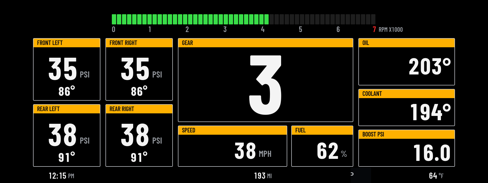

### Drag

A full-width shift bar and a 0 to 60 mph timer (0 to 100 km/h in metric). Stop for half a second and it reads READY; the clock starts the moment the car moves and stops at 60. Your best time is kept. Also the speed, the gear, the peak boost of the run, oil, coolant, fuel, and one readout you pick. The timer runs off the car's speed signal, which reads a little under BMW's speedometer, so treat it as a good guide rather than a timing gear.

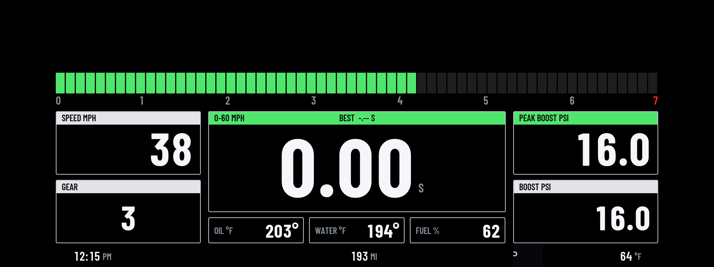

### Rally

A segmented rev arc sweeps across the top of the screen, white, then rally yellow from the shift zone, red and flashing at the redline. A huge gear sits in the middle with the speed under it. On the left a G-meter: a dot shows the cornering and braking or accelerating force (it moves into the turn and up when you speed up), white, then amber from 0.5 g, then red from 0.8 g, with a fading trail behind it and an outline of the most g you reached this drive in every direction. Under it the g now (left or right, accelerating or braking), and the best of the drive. Boost with a peak-hold bar and three readouts on the right (oil, coolant and fuel out of the box).

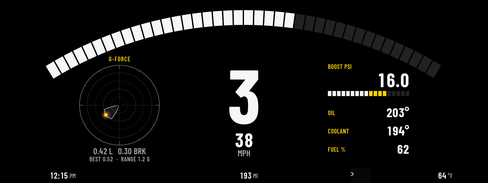

### Retro 80s

An 80s digital dash: amber seven-segment digits with their unlit 8s showing faintly behind, for the gear and the speed. A segmented rev bar runs across the top, bar graphs show oil, water and fuel on the left, and boost and two readouts sit on the right. The clock, range and outside temperature along the bottom are seven-segment digits too.

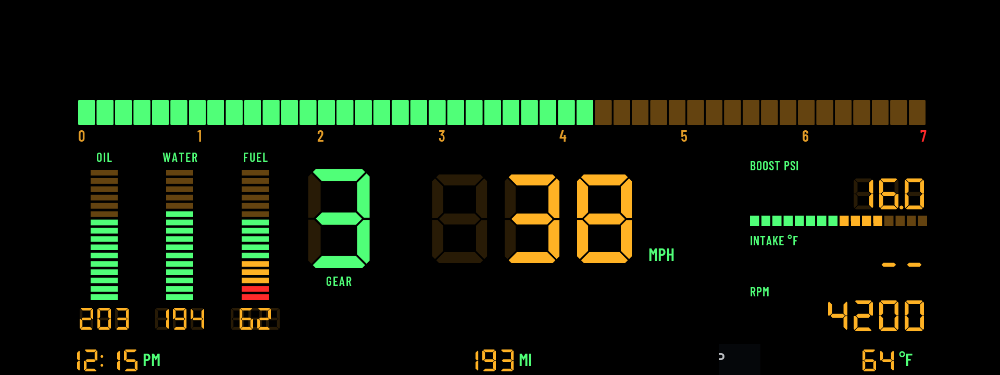

### Cruise

Calm and quiet for the highway: the speed in soft white, the gear beside it, and one row of figures (fuel, oil, coolant, rpm and your average speed this drive). No rev bar, and nothing red until the fuel runs low. The average speed counts only time moving and shows after the first minute of the drive.

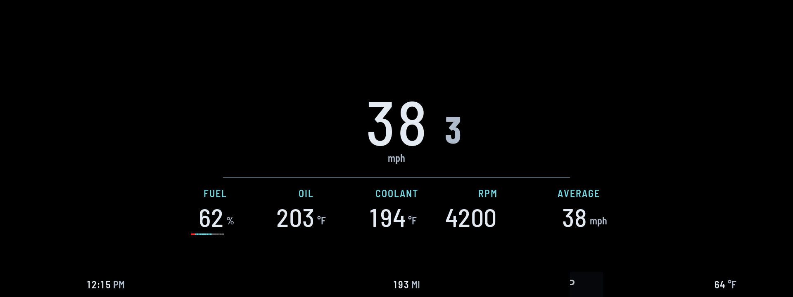

### Dyno

A safety dash for hard pulls, in BMW M colours: twelve tiles in a grid (rpm, speed, boost, oil, coolant, intake air, cornering g, braking or accelerating g, the gear, fuel, your shift point and your last shift) and tall Power and Torque tiles on the right, each with a bar that runs light blue, dark blue, then red. A tile's number flashes red while its oil, coolant or boost reading is over your warning limit. A rev bar runs across the top. Every tile but the gear can show another sensor (Readouts tab).

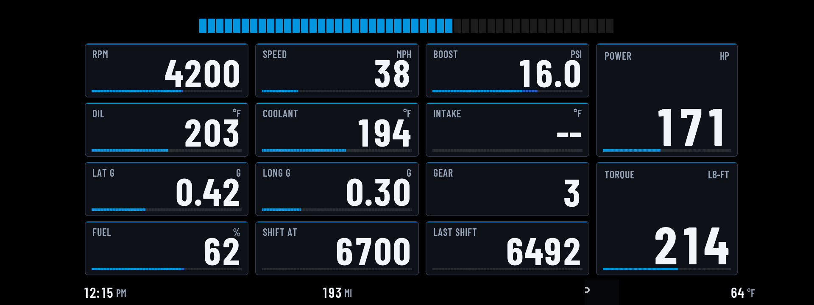

### Ribbon

Calm and premium. One ribbon of light runs along under the top edge of the cluster and fills with the revs, cool white warming to amber, then red near the redline, with a dot and a number at every thousand (the last two in red). The speed sits in the middle in big thin numbers with the gear in a small frame above it. Oil, coolant and boost are on the left, and fuel and your average speed this drive on the right.

**Holiday editions:** Christmas (the ribbon becomes a string of coloured bulbs that light up with the revs, with falling snow), Thanksgiving (falling maple leaves), New Year (bubbles and gold confetti) and the Fourth of July (fireworks), each with its own colours and a greeting under the speed. The decorations stay clear of the numbers. Set by **Holiday editions** in Settings.

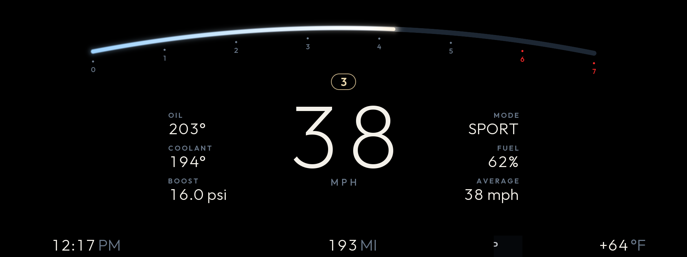

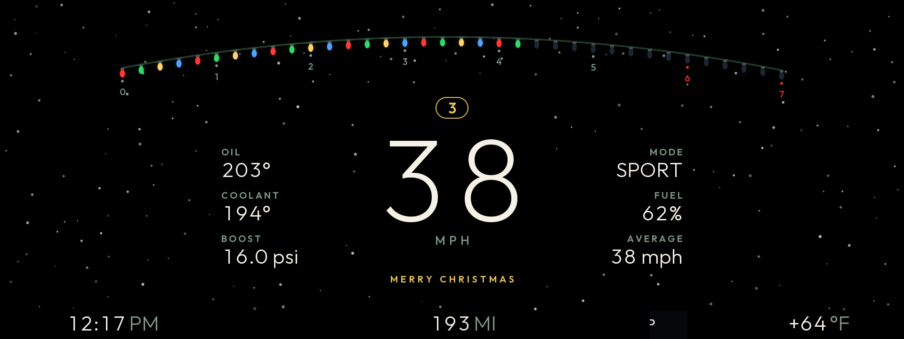

Minimal, Track, Drag, Rally, Retro 80s, Cruise, Dyno and Ribbon have no map window yet; with "Show Waze map inside the theme" on, Waze stays in its usual place while they show.

More themes are on the way.

## Off and drive modes

- **Off (BMW's own cluster):** pick it as the theme and the app draws nothing, so BMW's cluster comes back.
- **Change with SPORT / COMFORT / ECO PRO** (on by default): the cluster follows the drive mode buttons, with a theme for each mode. Out of the box, Sport shows GT3, and Comfort and Eco Pro show BMW's own cluster. Until the car reports a mode, the plain theme setting is used.
- **M cars:** the Efficient, Sport and Sport+ modes of M cars are not recognised yet, so the theme doesn't change with them. The last line of the Settings tab shows the value your car sends; please post it in an issue so it can be added.
- **With HUD Widgets:** on cluster-render 0.5.1 and newer, a cluster theme and a HUD layout show at the same time. On older cluster-render they share one screen slot and take turns: pick a theme while the HUD is on and the page asks whether to turn HUD Widgets off, and it asks the same the other way round.

## Settings

- **Theme**, and one per drive mode.
- **Readouts:** pick which car sensor each GT3, M, Track, Drag, Rally, Retro 80s or Dyno readout shows (speed, rpm, boost, temperatures, tyres, fuel, g, power and more). Plug-in hybrids can also show **Hybrid battery**, the high-voltage battery's charge in % (not yet checked on a hybrid).
- **Show Waze map inside the theme:** GT3, Sport and M open a window in the middle and Waze on Cluster draws its map in it, above BMW's own map view, so nothing shows twice. When the map goes away the theme fills back in. While it is on, Waze's map on the HUD is off. Needs robertnisipeanu's Waze on Cluster; turning it off gives Waze its usual place back.
- **Badge:** the model name, like "BMW X3 M40i", as text in the theme's font (GT3 top left, Sport, M and Minimal top centre, where BMW puts its own). Off by default.
- **Warnings:** oil, coolant and boost limits. A readout over its limit flashes red (oil 130°C and coolant 115°C by default, boost off).
- **Test the shift lights:** runs the rpm up to the shift point for about 4 seconds while the car stands.
- **Play demo:** the button at the top of the page plays a 60-second show on the cluster while the car stands (a pull through the gears with graded shifts, the limiter, braking, corners, boost, the oil warning once), with a DEMO tag. It stops at the end, on Stop, or as soon as the car moves, and nothing from it is kept.
- **Shift lights:** Count in (the default) fills the lights over about the last second before the shift point and flashes early by your reaction time; Fixed rpm band works as before. Ported from Redline (MIT).
- **Temperatures only when they matter** (off by default): oil and coolant turn blue while cold, yellow while warming, red over their limit; the outside temperature turns blue at 3°C (37°F) and under.
- **Night colours:** after sunset the theme's whites and greys dim to 60% (Auto, the default), or Off.
- **Units:** mph, °F, psi or km/h, °C, bar.
- **Clock:** 12-hour or 24-hour.
- **Time zone (clock):** the head unit's clock runs on UTC, so pick your zone once. Named zones (US Eastern, Central, Mountain, Pacific, Alaska, Hawaii, Arizona, Canada Atlantic, Mexico, UK / Ireland / Portugal, Central Europe, Eastern Europe) change for daylight saving by themselves; for anywhere else, pick your offset from UTC. Night colours uses the same zone to work out sunset.
- **Fuel tank size:** the fuel gauge asks the engine unit for the level in %. Where the engine unit doesn't answer, it works it out from the litres the car reports and this size (65 L on an X3, 59 L on a 3 Series).
- **Redline:** where the red marks start on the rev scales (they always cover at least the last 500 rpm, and the yellow marks sit in the 700 rpm before them).
- **Shift point before redline:** how far below the redline the shift lights peak (300 rpm by default).
- **Cold-engine rev guard:** until the oil reaches 80°C, the shift point starts at 4500 rpm and climbs as the oil warms up.
- **Show boost.**
- **Leave room for the driver camera** (off by default): for newer cars with a driver attention camera in the top middle of the cluster, where other cars show the model badge. The shift lights and rev bars (GT3, Track, Dyno, Rally) become two mirrored wings either side of the camera that fill from the outer ends in towards it and meet at the shift point, Track's rpm numbers are left out, M's logo is hidden, and Ribbon's ribbon dips under the camera instead. The camera's spot is taken from where the badge sits on a car without one. Not yet tested on a car with a camera; please report how it lines up on yours.
- **Holiday editions:** a string of glowing holiday lights along the top of every theme, and Ribbon's own holiday edition. Auto (the default) puts them on by the date: Thanksgiving in its week (Monday to Sunday), Christmas from December 1 to 26, New Year from December 27 to January 2, and the Fourth of July from July 1 to 5, then takes them off again. Or pick one holiday to keep it on, or Off. The date follows the Time zone (clock) setting.
- **G-meter** (its own tab): the range (0.8, 1.0, 1.2, 1.5 or 2.0 g at the edge; 1.2 by default), the trail (off, 1, 2 or 4 seconds), **Swap left / right** (if the dot goes the wrong way in a turn) and **Brake on top**, the best left, right, accelerating, braking and overall g of the drive with a Reset button, and a live copy of the meter. The g comes from the car's own acceleration sensor: parked on level ground it reads 0.00, and a hill adds a little.
- **Demo data:** fake driving data for trying it out parked. It switches back to the car's own data as soon as the car moves faster than 5 km/h.
- **Calibration grid:** a theme that draws lines every 50 px with labels, for checking on a photo where things land on the real screen. It also carries a few test marks used to measure cluster-render's limits on the car.
- **Map calibration:** a theme that leaves BMW's whole map window open with a grid through it, for photographing exactly what shows through the map cut-out with a navigation map up.

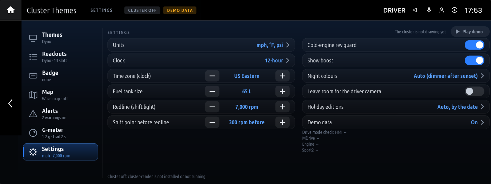

**Shift grades:** every upshift is graded on its peak rpm. EARLY means more than 250 rpm under the shift point, LATE more than 200 over it, COLD REV the same while the cold guard is on, LIMITER within 25 rpm of the redline, and anything in between is SPOT ON. Only shifts aimed at the shift point are graded: one more than 1500 rpm under it (an everyday shift) or one the gearbox made itself in D or S is left out, and the last grade stays on screen. When Redline 2.0.28 or newer is running, the shift point and the grade come from Redline, which learns a shift point for each gear.

## Requirements

[cluster-render](https://github.com/robertnisipeanu/idrive-apps), installed from the `robertnisipeanu/idrive-apps` Store source. Version 0.5.1 or newer lets the theme show together with HUD Widgets.

## On the car

Tested on a 2020 X3 M40i. Checked on the car: GT3 and Dyno draw complete, the Waze map shows inside GT3 and Sport, and a theme and a HUD layout show together. Still to be checked:

- the other themes on the real screen, including M since its 0.10.0 rework;
- whether BMW's warning lights still show over the dash (start the car with a seat belt off and look);
- the clock with a named time zone, and the fuel % from the engine unit;
- the Hybrid battery readout on a plug-in hybrid;
- Play demo, the count-in shift lights and the switch-off guard (0.16.0).

If something looks wrong on your car, the last line of the Settings tab says what the app is doing and why anything is not drawn. Please open an issue with it.

See [Use at your own risk](../../README.md#use-at-your-own-risk) before installing.

Version history is in the repo's [CHANGELOG.md](../../CHANGELOG.md).
